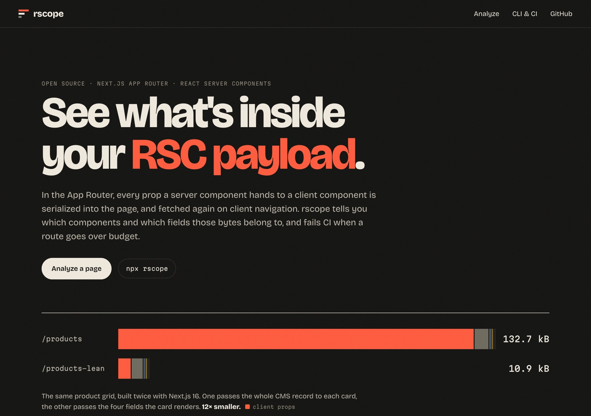
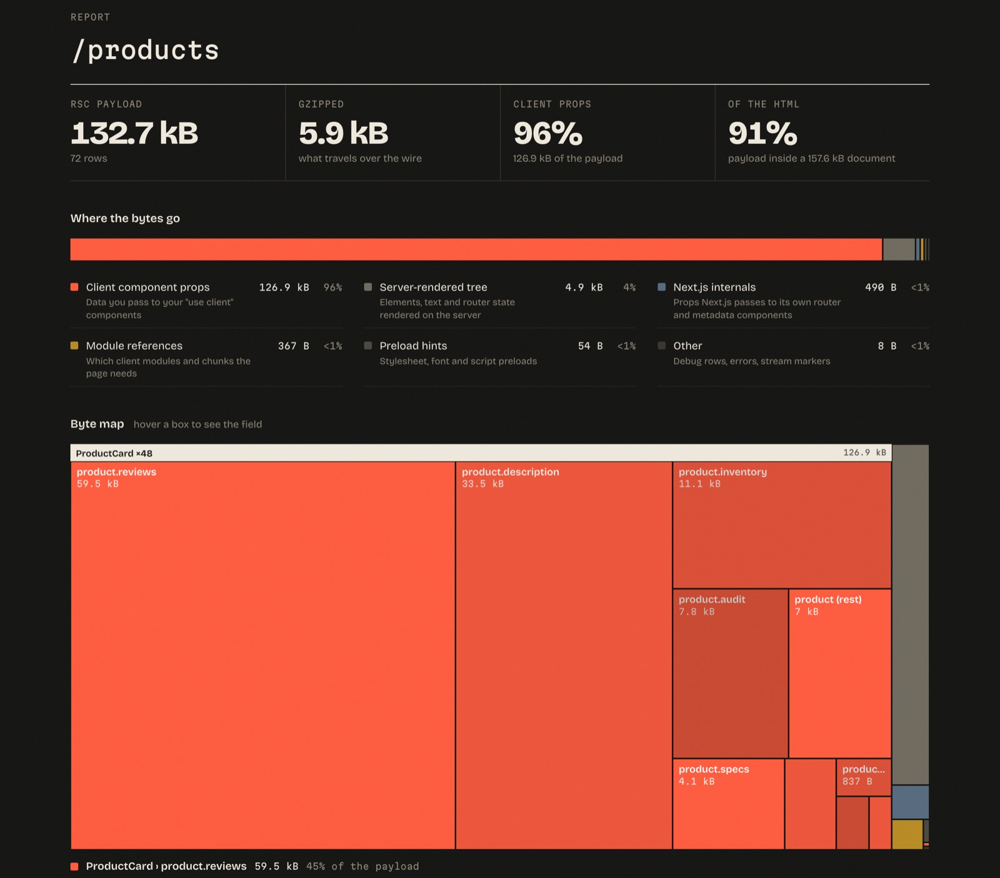

# rscope

**See what's inside your React Server Components payload.** rscope finds the props bloating your Next.js App Router pages, down to the field, and fails CI when a route goes over budget.

[](https://github.com/haris-devo/rscope/actions/workflows/ci.yml)
[](https://github.com/haris-devo/rscope/actions/workflows/contract.yml)
[](LICENSE)

**[Try it in the browser →](https://haris-devo.github.io/rscope/)** (runs locally, nothing is uploaded)

[](https://haris-devo.github.io/rscope/)

## Why

In the App Router, a client component can't fetch what the server already had, so React serializes every prop you pass it into the page. Hand a whole CMS record to a card that shows a name and a price, and the page carries the whole record, once per card. It ships inline in the HTML, then again as `.rsc` on every client navigation and prefetch.

The Pages Router warned you about this: once page data passed 128 kB, every build printed a "data for page … exceeds the threshold of 128 kB" warning. **The App Router has no equivalent warning.** Vercel's own guide on the subject suggests logging `JSON.stringify(props).length` by hand.

rscope does it properly. It parses React's Flight wire format, follows the references between rows, and credits every byte of the payload to a component, a prop path or the server-rendered tree. The buckets add up to the exact payload size.

## What it tells you

The [example app](examples/next-shop) renders the same product grid twice. `/products` passes each card the whole CMS record; `/products-lean` passes the four fields the card renders.

```text
$ next build && npx rscope --detail

     Route            Payload    gzip  Document  Client props       Largest client component
  ✓  /                 3.8 kB  1.4 kB    6.1 kB           9 B  <1%  CartBadge  9 B
  ✖  /products       132.7 kB  5.9 kB  157.6 kB      126.9 kB  96%  ProductCard ×48  126.9 kB
  ✓  /products-lean   10.9 kB  2.4 kB   27.2 kB        5.3 kB  48%  LeanProductCard ×48  5.3 kB

/products  payload 132.7 kB (gzip 5.9 kB)  ·  91% of a 157.6 kB document

  Where the bytes go
    Client component props  126.9 kB  ███████████████████████   96%
    Server-rendered tree      4.9 kB  █                          4%
    Next.js internals          490 B                            <1%
    Module references          367 B                            <1%

  Client components by props size
    ProductCard       126.9 kB  ×48  components/product-card.tsx
      product         126.4 kB
        .reviews       59.5 kB
        .description   33.5 kB
        .inventory     11.1 kB
        .audit          7.8 kB

  Repeated strings
    240×  "Fits true to size and the colour is exactly as pictured. Wo…"  35.9 kB wasted

  Findings
    ▲ ProductCard receives 126.9 kB of props (96% of the payload)
      48 instances, about 2.6 kB each. Biggest fields: product.reviews (59.5 kB),
      product.description (33.5 kB), product.inventory (11.1 kB). Every prop of a client
      component is serialized into the page. If ProductCard doesn't render all of this, pick
      the fields it needs on the server and pass only those.
    ▲ 2 strings are sent 288 times, wasting 68.7 kB
    ▲ The RSC payload is 132.7 kB
    ● The inline RSC payload is 91% of the HTML document

✖ /products is over budget: payload 132.7 kB > 128 kB
```

The fix is one `.map()` on the server, and the payload drops by 12×. The [web version](https://haris-devo.github.io/rscope/) shows the same report as a byte map you can hover:



### Works on real sites

rscope's accounting is exact (to the byte) on production App Router payloads, not just the example. A few public pages, measured on 2026-10-09:

| Page | Payload | What rscope points at |
|---|---:|---|
| nextjs.org/docs/app/getting-started | 202.6 kB | `DocsNavProvider` receives 117.6 kB: the whole docs navigation tree |
| ui.shadcn.com/docs/components | 274.9 kB | `MobileNav` gets 87.4 kB (`tree.children`), `CommandMenu` 59.6 kB (`colors[].colors`); 63 kB of module references |
| supabase.com | 76.9 kB | `FrameworksSectionClient` receives 49.1 kB, 64% of the payload |

Large isn't automatically wrong. A docs site may well want its nav tree on the client. The point is that rscope makes the trade-off visible, per component and per field.

## Quick start

```bash
next build
npx rscope
```

> rscope isn't on npm yet. Until it is, run it straight from GitHub: `npx github:haris-devo/rscope`.

With no arguments, rscope reads every prerendered App Router route in `./.next`. It reads source paths from the build's client reference manifests, so components show up as `components/product-card.tsx` rather than `module 21871`. Point it elsewhere with a target:

| Target | What rscope analyzes |
|---|---|
| `.next` or a project directory | Every prerendered route from `next build` |
| `page.html` | A saved document and the payload inlined in it |
| `page.rsc` | A raw payload, e.g. `curl -H 'RSC: 1' https://your.app/page` |
| `https://your.app/page` | A live page. Use this for dynamic routes, against `next start` or production. Add `--rsc` to fetch the navigation payload instead of the HTML. |

### Options

| Option | |
|---|---|
| `--budget <size>` | Payload budget for routes without one in the config. Default `128kB`. |
| `--config <file>` | Budget config. Default `rscope.config.json`, if present. |
| `--detail` | Full breakdown for every route (automatic for a single route). |
| `--all` | Include Next.js internals (router, metadata boundaries) in component lists. |
| `--top <n>` | How many components, fields and strings to list. Default 5. |
| `--json` | Machine-readable report. |
| `--markdown` | Markdown report, for PR comments. |
| `--summary <file>` | Also append the Markdown report to a file, e.g. `"$GITHUB_STEP_SUMMARY"`. |

Exit codes: `0` within budget, `1` over budget, `2` bad input.

## Budgets

The default budget is a 128 kB payload per route, the same threshold the Pages Router used. Set your own in `rscope.config.json`:

```json
{
  "$schema": "https://raw.githubusercontent.com/haris-devo/rscope/main/schema.json",
  "budgets": [
    { "route": "/products/**", "payload": "100kB", "clientProps": "40kB" },
    { "route": "/blog/*", "payload": "60kB", "payloadGzip": "12kB" }
  ],
  "defaultBudget": { "payload": "128kB" },
  "ignore": ["/admin/**"]
}
```

| Metric | Measures |
|---|---|
| `payload` | Raw RSC payload. This is what the browser parses and holds in memory. |
| `payloadGzip` | Gzipped payload, which is roughly what travels over the wire. |
| `document` | The whole HTML document, payload included. |
| `clientProps` | Bytes of props passed to your client components. |

The first budget whose `route` pattern matches applies. `*` matches one path segment and `**` matches any number. Sizes use decimal units, like Next.js and DevTools: `1 kB = 1000 bytes`.

> **Raw or gzip?** Repeated data compresses well, which is why `/products` is 132.7 kB raw but 5.9 kB gzipped. Gzip hides the problem on the network tab, but the browser still decompresses, parses and keeps all 132.7 kB before hydration. So rscope budgets the raw payload by default.

## GitHub Action

```yaml
- run: npm run build
- uses: haris-devo/rscope@v0
  with:
    budget: 100kB          # optional; rscope.config.json is read too
    # path: apps/web/.next # for monorepos
```

The action writes the report to the job summary, adds an error annotation for each route over budget, and fails the job. Node.js 20 or later must be on the runner, which it is on GitHub-hosted runners.

## How it works

1. **Find the payload.** In a document, Next.js inlines it as `self.__next_f.push([1, "..."])` scripts. rscope joins the chunks, decoding binary ones, into the same byte stream the client router reads.
2. **Parse rows.** The Flight format is a stream of rows: `id:JSON`, `id:I[module, chunks, export]` for client modules, `id:T<hex length>,<text>` for long strings. Lengths count UTF-8 bytes, so rscope parses bytes, not characters.
3. **Walk the tree and credit every byte.** An element is `["$", type, key, props]`. When `type` points at an `I` row, the element is a client component, and its props (except `children`, which is rendered output passing through) are data it receives. References like `"$3"` pull outlined rows into whichever prop references them first. Every byte lands in exactly one bucket, and the tests check that the buckets add up to the payload size.

The core is dependency-free TypeScript that runs unchanged in Node and the browser: the CLI and the website share it. The full design, including the byte-accounting invariant and the reasoning behind each finding's thresholds, is in [docs/architecture.md](docs/architecture.md).

## Compatibility

Tested against real `next build` output from **Next.js 14 (React 18), 15 and 16, with Turbopack and webpack**. The [contract workflow](.github/workflows/contract.yml) rebuilds the example app against every supported major, plus `latest` and `canary`, every week. A format change in a new release fails there before it reaches users.

Known limits:

- From `.next`, rscope sees prerendered (static and ISR) routes. For dynamic routes, point it at a URL.
- Without a build directory (URL or file targets), there is no manifest, so default-exported components are named by module id.
- Props that reference the same outlined object are credited to the first component that uses them, matching what is actually sent: React sends that object once.

## Development

```bash
npm install
npm test             # unit tests, plus analysis of a real Next.js build in test/fixtures
npm run typecheck
npm run dev -- test/fixtures/next-shop --detail   # run the CLI from source
npm run dev -w web   # the website, at localhost:5173/rscope/
npm run fixtures     # rebuild examples/next-shop and refresh the test fixtures
```

## License

MIT © [Haris Ahmed](https://github.com/haris-devo)
